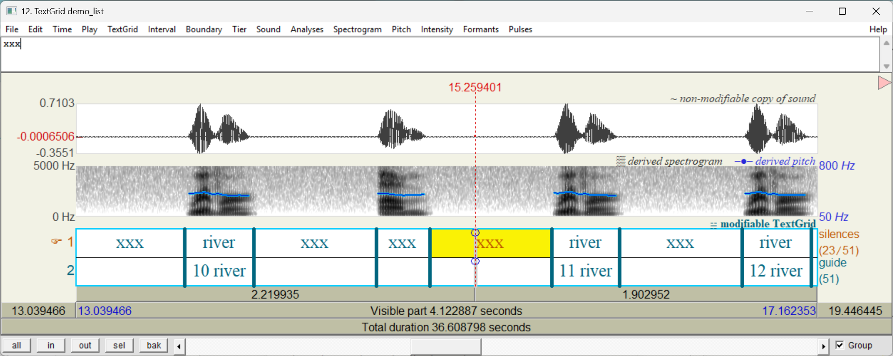

# Stimulus recording pipeline (Praat)

A Praat script that turns **one recording of a word list** into **one cleaned-up WAV file per word**.

You record a speaker reading a list (optionally saying each word several times in a row), give the
script the recording and a CSV of the words in reading order, and it

1. finds the words and pauses automatically,
2. opens the TextGrid editor until the number of words matches the CSV,
3. labels every word from the CSV, in order,
4. opens the editor once more for a final check, and
5. cuts each word into its own file, with padding, fades, optional amplitude and duration
   normalization, and optional added silence.

It also writes the TextGrid and a log of every file it made, so the cutting is documented and can be
redone.



**Tutorial:** a step-by-step walkthrough with screenshots is at
<https://maypychan.github.io/praat-stimulus-pipeline/>
(also in this repository as [docs/index.html](docs/index.html)).

---

## Requirements

- [Praat](https://www.fon.hum.uva.nl/praat/), a recent version. Tested with Praat 6.4.43 on
  Windows 11; much older versions may lack functions the script uses (string vectors, matrices).
- No add-ons or plugins. The script uses only standard Praat commands, so it should run wherever
  Praat runs, but it has only been tested on Windows.

## Files in this release

| File | What it is |
|---|---|
| `stimulus_pipeline.praat` | the script |
| `example/demo_list.wav` | a 37-second synthetic demo recording: 8 English words, each said 3 times, with one extra "um" |
| `example/demo_list.csv` | the matching word list (column `stimuli`) |
| `example/demo_tuning.wav`, `example/demo_tuning.csv` | a 42-second noisy demo (12 words x 3) for trying *tune settings* |
| `example/demo_output/` | logs, a duration table and a tuning table from runs on the demos, for comparison |
| `docs/index.html` | the tutorial, with screenshots (published with GitHub Pages) |
| `docs/tutorial.Rmd`, `docs/images/` | the tutorial's source and its screenshots |
| `LICENSE`, `CITATION.cff` | the MIT license and citation information |

## Quick start

1. Put your recording (WAV, mono or stereo) and your word list CSV somewhere near the script.
2. Open Praat, choose **Praat > Open Praat script...**, and open `stimulus_pipeline.praat`.
3. In the script window, choose **Run > Run** (Ctrl+R).
4. Fill in the form (see below) and click **OK**.
5. Follow the pause windows: fix the word count if asked, check the labels, then click **Cut stimuli**.

The form opens with the demo recording and word list already filled in. To try it, set
*repetitions per word* to `3` and click **OK**.

Relative paths are read relative to the folder the script is in, not Praat's working folder, so the
demo works wherever you put the release folder. You can type paths with `/` or `\` on any system:
the script turns `\` into `/`, which Praat understands on Windows, Mac and Linux. Forward slashes
are the safest choice if you share settings between computers.

## Preparing your input

**The recording.** One file per speaker or session. Any format Praat reads (WAV is safest). Stereo
files are converted to mono. Leave a clear pause between tokens: pauses of at least about half a
second segment most reliably. A second or so of silence at the start helps.

**The CSV.** A comma-separated file with a header row. One column holds the words, one per row, in
the order they were read. Other columns are ignored, so you can keep notes, conditions or
transcriptions next to the words. UTF-8 text works, including non-Latin scripts.

```
stimuli
apple
banana
window
```

If each word was said *n* times in a row, list it **once** and set *repetitions per word* to *n*.
The script then expects (rows x repetitions) words in the recording.

## The form

| Field | Default | Meaning |
|---|---|---|
| sound file | `example/demo_list.wav` | the recording |
| csv file | `example/demo_list.csv` | the word list |
| stimuli column | `stimuli` | name of the CSV column with the words |
| repetitions per word | 1 | how many times each word was said in a row |
| output folder | `output` | where results go; a subfolder named after the recording is made inside it |
| export repetitions | (empty) | e.g. `2` or `2 5`: also copies every `word_2` (and `word_5`) file into `stims_2` (`stims_5`), with a table of their durations |
| padding ms | 20 | audio from the original recording kept before and after each word |
| fade ms | 5 | raised-cosine fade-in and fade-out at the file edges |
| leading / trailing silence ms | 0 | digital silence added before / after each file |
| amplitude normalization | none | `none`, `peak` (scale to the peak target, 0.99 by default), or `intensity (RMS)` (scale the word to *target intensity db*) |
| target intensity db | 70 | target for RMS normalization |
| target duration ms | 0 | if above 0, stretches or compresses every word to this duration (Praat's overlap-add Lengthen) |
| tune settings | off | optional first step: you correct the first stretch of the recording by hand, and the script tests 150 segmentation settings on it (see below) |
| tuning stretch s | 180 | length of that stretch |
| advanced settings | off | opens a second window with the segmentation and check settings |

## What happens when you click OK

**Segmentation.** The script band-pass filters the recording (80-8000 Hz), runs Praat's
*To TextGrid (silences)* on its intensity, then

- *merges split words*: joins two intervals across a pause shorter than 0.35 s when the result is at
  most 1.6 times the median word duration (this repairs words split at a stop closure, such as
  *back-pack*), and
- *widens edges*: extends each word outward while the intensity stays above -40 dB re. the maximum
  (at most 0.2 s, never past the middle of the pause), so weak onsets and offsets like /f/ or /h/
  are not clipped.

It also warns you if the silence threshold is within 10 dB of the recording's noise floor.

**Fixing the count.** If the number of word intervals does not match the CSV, the TextGrid editor
opens with a pause window. Tier 1 (`silences`) holds the segmentation: pauses are labelled `xxx`
and words are left empty. Tier 2 (`guide`) numbers the words and shows the CSV word each one will
get, plus warnings. Fix tier 1 (add or remove boundaries, label coughs, false starts and extra
words `xxx`) and click **Recheck**. The guide tier is rebuilt on every check and is never used for
cutting.

If you typed text into a word interval by mistake, it is reported as *stray text*; the
**Stray text = silence** button turns all such labels into `xxx`.

**Labelling and final check.** Once the count matches, every word interval gets its CSV word, and
the editor opens again. Check the labels and boundaries. If you add, remove or move boundaries,
click **Relabel from csv** to fill the words in again in order (this replaces labels you typed). If
the count no longer matches, you go back to fixing it. Click **Cut stimuli** when you are done.

Do not close the editor window yourself; use the buttons in the pause window. **Stop** ends the
script and leaves the Sound and TextGrid in the Objects window, so nothing you edited is lost.

**Warnings on the guide tier.**

| Flag | Meaning |
|---|---|
| `SHORT` | word shorter than 100 ms (often a click, breath, or a fragment of a split word) |
| `LONG` | word longer than 1500 ms (often two words merged) |
| `SHIFT+1`, `SHIFT-1`, ... | from the repetition pattern: pauses between *different* words are usually longer than between repetitions of the same word. When the pauses fit the CSV better shifted by one or two words, the stretch is flagged. `-1` usually means an extra interval near the start of the stretch, `+1` a missing or merged word. Needs at least 30 words and more than one repetition per word. |

A full list with times is printed in the Info window.

## Output

Everything goes into `<output folder>/<recording name>/`. If that folder already has files in it,
the script asks whether to overwrite (files with the same names are replaced, others stay) or to use
a new folder (`<name>_2`, `<name>_3`, ...).

| File | Contents |
|---|---|
| `<word>.wav` | one file per word. A label that occurs more than once gets numbered in recording order: `apple_1.wav`, `apple_2.wav`, ... Characters not allowed in file names (`\ / : * ? " < > \|` and spaces) become `_`. |
| `<recording>.TextGrid` | the final, labelled TextGrid (tier 1 is the one used for cutting) |
| `<recording>_log.csv` | one row per file: `n`, `label`, `file`, `rep` (repetition number), `start` and `end` in the recording (s), `word_ms` (word duration after any duration normalization), `file_ms` (whole file), `clipped` (1 if the file's peak exceeded 1), `note` |
| `stims_<k>/` and `sf_dur_<k>.csv` | only with *export repetitions*: copies of every repetition-*k* file, and a table of `sound_file_name` and `sound_duration` (s) |
| `<recording>_tuning.csv` | only with *tune settings*: the score of every setting tested |

Each file is built in this order: cut the word, normalize its duration (if set), add the padding
from the original recording, apply the fades, normalize the amplitude (if set), add the leading and
trailing silence, save. Files whose peak goes above 1 are reported as clipped in the Info window and
the log, because WAV saving would clip them; use peak normalization or a lower RMS target if that
happens.

## Optional: tuning the settings on your own recording

With *tune settings* on, the script first segments the recording with the current settings and
marks the first stretch (180 s by default) on a `tuning` tier. You correct that stretch by hand:
every list word in its own empty interval, everything else `xxx`. The script then scores 150
combinations of silence threshold (-20 to -40 dB), minimum silent interval (0.15-0.35 s), minimum
sounding interval (0.05-0.15 s) and word merging on your corrected stretch, counting the corrections
each one would need. It switches to the best one only if it needs at least 3 and 30% fewer
corrections than the current settings. Your corrections of the stretch are kept either way. The
stretch must hold at least 10 words.

This is worth doing for long recordings, noisy rooms, or speakers whose pauses differ from the
defaults. The tutorial walks through it on `example/demo_tuning.wav`, a noisy recording where the
default settings would need 6 corrections (merged words) in the first 22 s and the tuned settings
none. It also
has a section on choosing settings from what you know about your stimuli.

## Advanced settings

| Setting | Default | Meaning |
|---|---|---|
| Minimum pitch | 100 Hz | for the intensity analysis (lower it for low voices) and the minimum pitch for duration normalization |
| Time step | 0 | intensity time step (0 = automatic) |
| Silence threshold | -30 dB | re. the maximum intensity; frames below it count as silence |
| Auto threshold | off | sets the threshold to the midpoint of the 25th and 75th intensity percentiles |
| Minimum silent interval | 0.2 s | shorter pauses do not split words |
| Minimum sounding interval | 0.1 s | shorter sounds are not words |
| Merge split words, Merge max pause, Merge max ratio | on, 0.35 s, 1.6 | see *Segmentation* above |
| Widen edges, Edge threshold, Edge max | on, -40 dB, 0.2 s | see *Segmentation* above |
| Short interval, Long interval | 100 ms, 1500 ms | limits for the `SHORT` / `LONG` flags |
| Check repetition pattern | on | the `SHIFT` flags |
| Target peak | 0.99 | for peak normalization |
| Maximum pitch | 600 Hz | for duration normalization |

## Troubleshooting

- **"Cannot find a column called ..."**: the *stimuli column* name does not match the CSV header
  (check spelling, capitals, and that the file is comma-separated).
- **Many merged words or a noise-floor warning**: raise the silence threshold (e.g. from -30 to
  -25 dB), or use *tune settings*.
- **Many split words**: raise *minimum silent interval*, or check that *merge split words* is on.
- **Very short words skipped**: lower *minimum sounding interval*.
- **"too short to normalize duration"** in the log: the word is shorter than three pitch periods at
  the minimum pitch, so its duration was left unchanged.
- **Export made no `stims_k` folder**: no word has a repetition *k* (for example, *repetitions per
  word* is 1).

## Citing and license

If you use the script to prepare stimuli for a study, please cite it:

> Chan, M. P. Y. (2026). *Stimulus recording pipeline: a Praat script for cutting word-list
> recordings into stimulus files* (Version 1.0.0) [Computer software].
> <https://github.com/maypychan/praat-stimulus-pipeline>

Please also cite Praat:

> Boersma, P., & Weenink, D. (2026). *Praat: doing phonetics by computer* [Computer program].
> <https://www.praat.org>

GitHub's **Cite this repository** button (from [CITATION.cff](CITATION.cff)) gives the citation in
APA and BibTeX formats. In a methods section, it helps to report the settings you used: the log and
the Info window list them for every run.

The script is released under the [MIT License](LICENSE). You may use, modify and share it freely,
as long as the copyright notice is kept.

The demo recordings in `example/` were made with the text-to-speech voices built into Windows, so
they contain no real speaker's voice.
